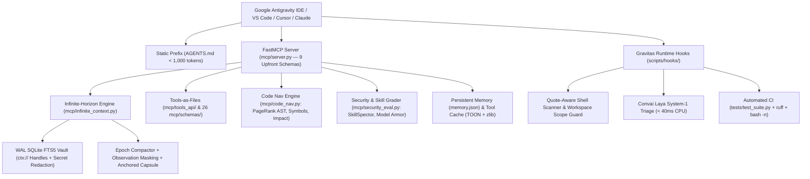

# Antigravity Ecosystem Architecture

## Components

- **Control Plane (`AGENTS.md` + `config/`)**: Static KV-cache-friendly contract (`< 1,000` tokens), `hooks.json`, clean seed `memory.json`, `repomix.json`, `ruff.toml`, `runtime.json`, `system_prompt.md`.
- **FastMCP Modular Runtime (`mcp/`)**:
  - `server.py`: Upfront `FastMCP("god-mode")` exposing `9` `@app.tool()` schemas (`<= 10` limit) and re-exporting all helper APIs.
  - `infinite_context.py`, `context_vault.py`, `text_filters.py`: Preventative FTS5 `ContextVirtualizer`, `cli_compress`, secret redaction, DCP transformations, Observation Masking, and Epoch Compaction.
  - `code_nav.py`: Pure-Python AST + `ast-grep` outline/symbol extraction, PageRank repo map, two-pass caller/importer impact analysis, diff-only re-reads.
  - `security_eval.py`: SkillSpector scanner (with method-free `eval`/`exec` and emoji-ZWJ precision), Model Armor secret redactor, A2A cards, and 100-point skill evaluator.
  - `ops_helpers.py`: Token audit, TOON serializer, compressed output cache, checkpoints, and doctor runners.
  - `tools_api/` & `schemas/`: 6 on-demand Python stub modules matching all 26 JSON tool schemas.
- **Customizations (`agents/`, `skills/`, `rules/`, `workflows/`)**: 65 agents, 231 skills, 11 rule directories, and 4 multi-agent/token workflows.
- **Setup & Installers (`installer/`, `scripts/`)**: Cross-platform setup/uninstaller, MCP registrar, chat cleaner, backup archiver, and health doctor.
