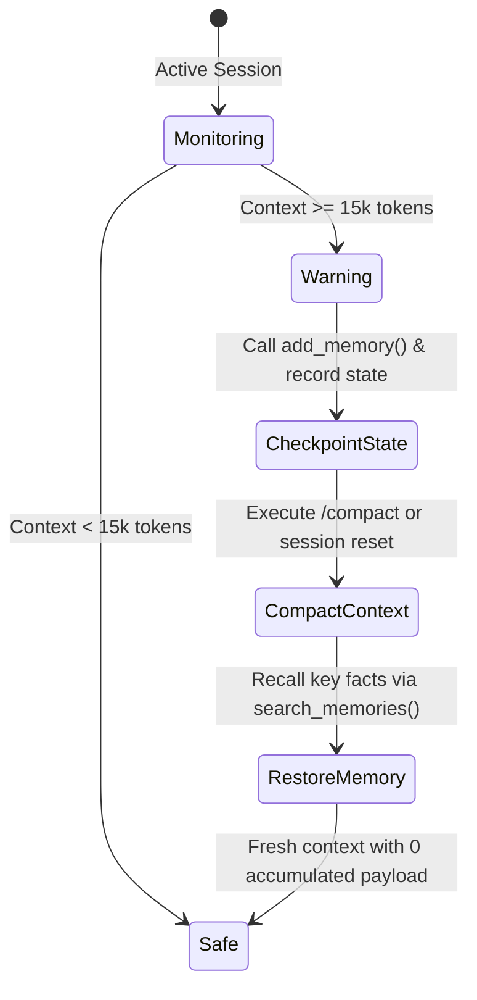

# Antigravity Telemetry & Token Runway Protocol

Maintains peak GPU KV-cache hit rates and monitors conversational context economics across Google Antigravity IDE and VS Code.

---

## Telemetry Metrics & Boundaries

| Metric | Target | Warning Threshold | Remediation Action |
| :--- | :--- | :--- | :--- |
| **System Prompt Token Budget** | < 1,500 tokens | >= 1,450 tokens | Prune volatile rules, freeze static prefix |
| **KV-Cache Hit Rate** | >= 75% | < 60% | Eliminate dynamic dates/timestamps in prompts |
| **Single-Turn Read Budget** | <= 150 lines | > 300 lines | Enforce bounded slicing (`get_symbol` / `get_file_outline`) |
| **Conversation Bag Size** | < 15,000 tokens | >= 20,000 tokens | Trigger `/compact` or reset chat (`Ctrl+Shift+L`) |
| **Terminal Log Noise** | <= 2 lines | > 20 lines | Run `system1_triage` on local CPU |

---

## Token Runway Prediction & Compaction Loop

---

## Best Practices for Token Efficiency
1. **Turn 1 Recall**: Always begin unfamiliar workflows with `search_memories(query="<keyword>")` to retrieve cached architectural facts.
2. **Deterministic Checkpointing**: Call `token_audit.py --checkpoint` before performing multi-file refactoring.
3. **Session Freshness**: Resetting chat history does NOT erase knowledge; Mem0 guarantees learned insights persist permanently on disk.
