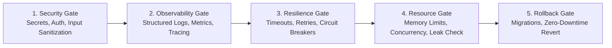

# Production Readiness & Hardening Protocol

Standard operating procedure to audit, verify, and harden software architectures before production deployment.

---

## Readiness Checklist (The 5 Production Gates)

---

## Gate 1: Security & Confidentiality
- [ ] **Secret Scan**: No hardcoded API keys, tokens, or private credentials in source code. Run `model_armor_sanitize`.
- [ ] **Input Validation**: All external inputs, query parameters, and headers validated with strict schemas (Zod, Pydantic, Marshmallow).
- [ ] **Injection Defense**: Parameterized database queries; AST-inspected shell invocations.

---

## Gate 2: Observability & Health Probing
- [ ] **Liveness & Readiness Endpoints**: `/healthz` and `/readyz` probes implemented and responsive.
- [ ] **Structured Logging**: JSON-formatted logs with correlation IDs (`request_id`, `trace_id`).
- [ ] **Metrics Collection**: Standard Prometheus / OpenTelemetry counters for request rate, latency (p95/p99), and error rate.

---

## Gate 3: Failure Resilience
- [ ] **Explicit Timeouts**: Every outbound HTTP/gRPC call or subprocess has a strict non-infinite timeout.
- [ ] **Exponential Backoff**: Retries on transient failures with jitter to prevent thundering herd.
- [ ] **Graceful Degradation**: Fallbacks defined when secondary services or caches are unreachable.

---

## Gate 4: Resource Boundaries
- [ ] **Memory Allocation**: Docker / K8s cgroups memory limits configured.
- [ ] **Connection Pooling**: Database and Redis connection pools bounded with idle recycling.
- [ ] **Clean Shutdown**: Handles `SIGTERM` / `SIGINT` cleanly, draining in-flight requests within deadline.

---

## Gate 5: Rollback & Deploy Safety
- [ ] **Database Migrations**: Backward-compatible migrations (expand-contract pattern).
- [ ] **Deterministic Rollback Plan**: Documented 1-command rollback procedure without data loss.
