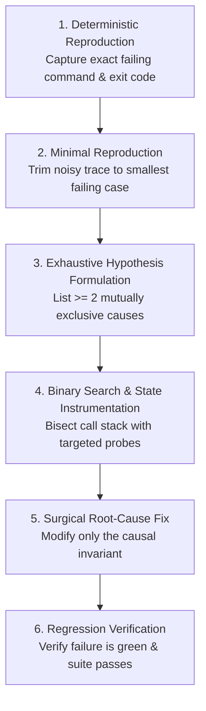

# Systematic Debugging Protocol

The gold-standard debugging runtime for autonomous AI engineers. Eliminates speculative guesswork through a disciplined 6-stage scientific protocol.

---

## The 6-Stage Scientific Debugging Ladder

---

## 1. Deterministic Reproduction
Never attempt to fix a bug without an active failing test or reproducible command:
1. Run the test/command in isolation (`pytest tests/test_foo.py -k test_failing_case`).
2. Record the exact exit code and traceback.
3. If no test reproduces the bug, write a minimal reproducing test case **first**.

---

## 2. Minimal Reproduction & Noise Elimination
1. Strip external side effects, database latencies, and network dependencies.
2. Pass noisy tracebacks through `system1_triage` to extract the 1-line distilled root cause on local CPU (0 tokens burned).
3. Identify the exact line and symbol triggering the fault.

---

## 3. Multi-Hypothesis Formulation
Formulate at least 2 distinct hypotheses before modifying any source code:
- **Hypothesis A (Call-site error)**: Caller passes unexpected payload, wrong type, or unhandled null/None.
- **Hypothesis B (Callee invariant violation)**: Function internal logic fails on boundary condition (empty list, off-by-one, encoding).
- **Hypothesis C (State/Concurrency race)**: Mutable shared state or unawaited coroutine.

Document hypotheses explicitly in scratchpad or conversation log.

---

## 4. Binary Search Instrumentation
Bisect the execution path to locate the exact divergence point:
- Log intermediate values immediately before and after the suspected expression.
- Use assert statements to test assumptions: `assert value is not None, f"Expected non-null at step 3, got: {value}"`.
- Inspect callers via `code_reference_probe` before mutating shared methods.

---

## 5. Surgical Fix (Zero Collateral Damage)
- Apply the minimal change required to restore the broken invariant.
- Never refactor surrounding unrelated code in the same edit.
- Avoid swallowing errors (`except Exception: pass`). Always log or handle explicitly.

---

## 6. Regression Verification
- Re-run the reproducer: must exit code 0.
- Re-run the full unit test suite: verify zero regressions.
- Store the solved pattern in Mem0 via `add_memory` to prevent repeat failures.
