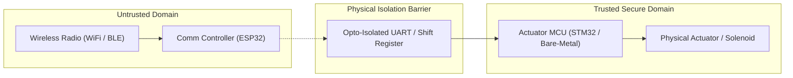

# Air-Gapped Physical Firewall & Hardware Roots-of-Trust

Security specifications for embedded access control, air-gapped physical interfaces, and hardware cryptographic trust anchors.

---

## 1. Air-Gapped Physical Firewall Architecture



- **Physical Decoupling**: Untrusted wireless transceivers have NO direct hardware or memory connection to physical actuation circuits.
- **Unidirectional / Rate-Limited Interconnect**: Commands cross through strict hardware baud rate limiters and opto-isolated channels. Buffer overflows in the wireless stack cannot manipulate internal actuator registers.

---

## 2. Galois LFSR Hardware Roots-of-Trust

- Implement maximal-period Galois Linear Feedback Shift Registers (LFSR) in Verilog HDL for low-overhead on-chip pseudo-random permutation and authentication challenges:
  ```verilog
  module galois_lfsr #(parameter WIDTH = 32, parameter TAPS = 32'h80200003) (
      input  wire             clk,
      input  wire             rst_n,
      input  wire             enable,
      output reg  [WIDTH-1:0] lfsr_data
  );
      always @(posedge clk or negedge rst_n) begin
          if (!rst_n)
              lfsr_data <= 32'hACE1;
          else if (enable)
              lfsr_data <= (lfsr_data >> 1) ^ (-(lfsr_data & 1'b1) & TAPS);
      end
  endmodule
  ```
