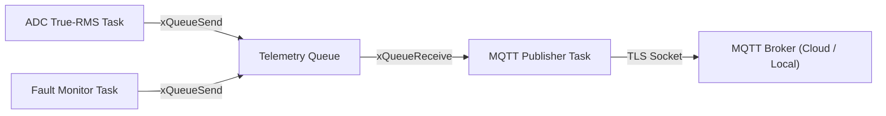

# Industrial IoT Telemetry & High-Reliability MQTT

Production patterns for streaming real-time hardware telemetry from FreeRTOS embedded devices to cloud brokers (HiveMQ, AWS IoT, EMQX).

---

## 1. FreeRTOS Telemetry Queue Architecture

- **Decoupled Sampling**: Sensor sampling runs on dedicated deterministic priority threads. Telemetry publishing runs on a lower-priority network task.
- **Queue Overrun Protection**: Use bounded queues. If network drops, discard oldest non-critical telemetry frames while strictly preserving critical hardware trip/alert events.

---

## 2. Payload Structure & QoS Guidelines

- **QoS 0**: High-frequency periodic telemetry (voltage, current, temperature readings every 100ms).
- **QoS 1**: Discrete state changes and threshold warnings (load breaker switched ON/OFF).
- **QoS 2**: Critical safety trips, emergency shutdowns, and firmware verification handshakes.
- **Compact JSON / Protocol Buffers**: Strip whitespace and precision bloat to minimize cellular / Wi-Fi bandwidth.
